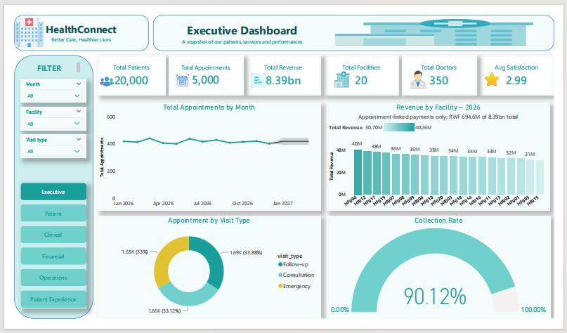
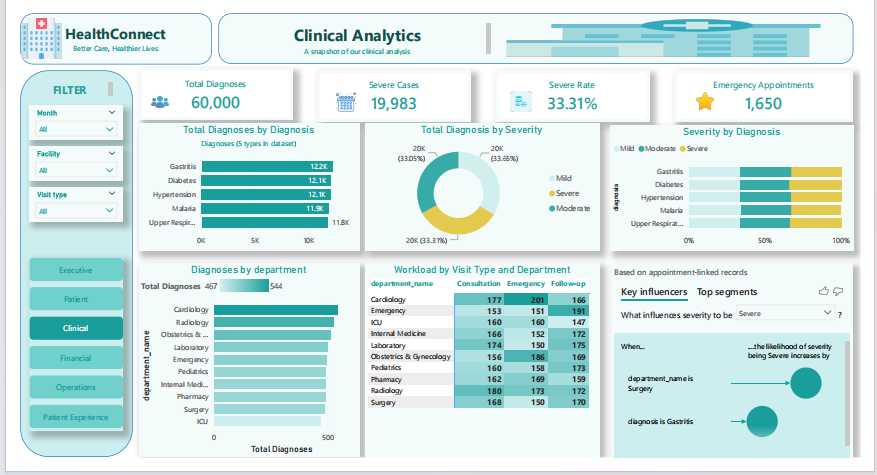
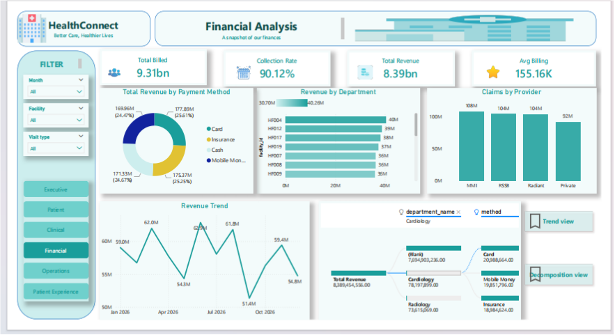
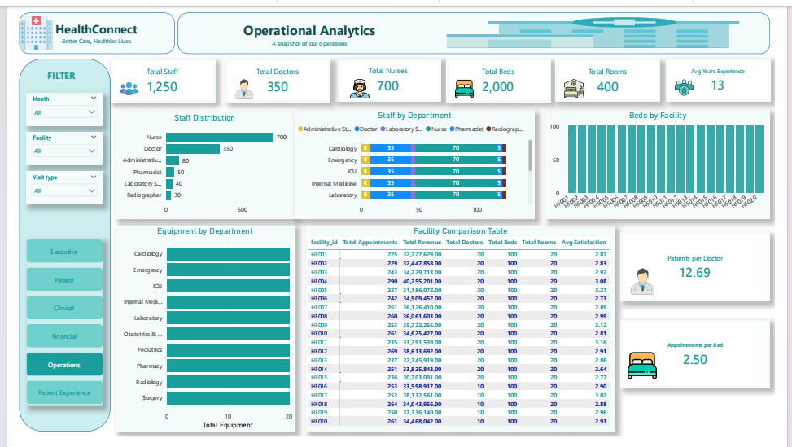
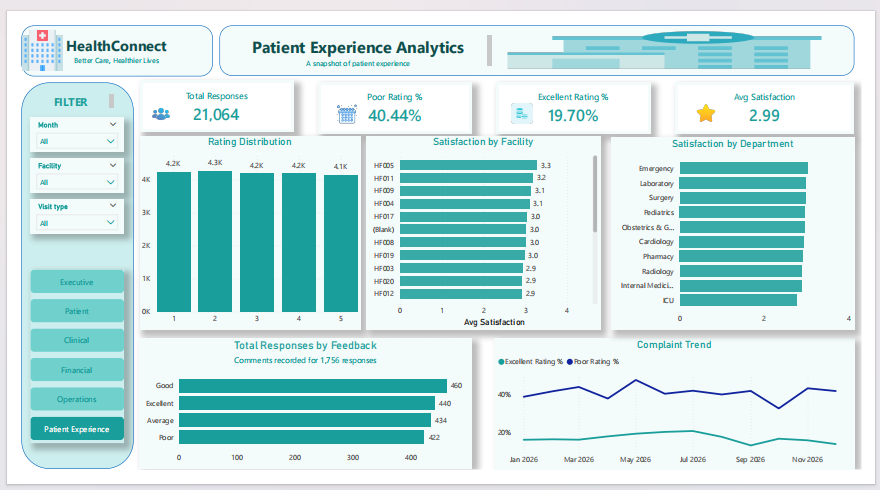

# HealthConnect Rwanda: Healthcare Operations & Performance Analytics

**AnalystLab Africa Experience Lab | Week 6 | Data Analytics Track**
**Author:** Olabisi Amusan | [LinkedIn](https://linkedin.com/in/amusanolabisi) | [GitHub](https://github.com/amusanolabisi)

---

## Overview

An end-to-end analytics solution for HealthConnect Rwanda, built to help executive management monitor patient care, hospital operations, financial performance and patient experience.

The project covers:
- a PostgreSQL database built from the supplied CSV datasets,
- 40 SQL queries answering the assignment's business questions,
- a 6-page interactive Power BI executive dashboard, plus a drill-through page and a tooltip page,
- documented data-quality findings and recommendations.

---

## Dashboard Preview

### 1. Executive Dashboard


### 2. Patient Analytics


### 3. Clinical Analytics


### 4. Financial Analysis


### 5. Operational Analytics


### 6. Patient Experience


---

## Repository Contents

```
HealthConnect-Rwanda/
├── sql/
│   ├── 01_schema_load_validation.sql   # schema, cleaning, views, data-quality checks
│   └── 02_business_queries.sql         # the 40 SQL business tasks
├── database/
│   └── healthconnect.backup            # PostgreSQL backup (custom format)
├── powerbi/
│   ├── Healthconnect_Rwanda.pbix            # Week 6 version
│   └── Healthconnect_Rwanda_Week_7.pbix     # Week 7 refined version
├── testing/
│   └── HealthConnect_Test.xlsx              # Week 7 test log
├── reports/
│   └── Week7_Testing_and_Refinement_Report.pdf
└── evidence/week7/                          # screenshots (filter tests, retests, cross-track)hboard screenshots used above
└── README.md
```

---

## Tools

- PostgreSQL 18 and pgAdmin 4 (database, SQL)
- Power BI Desktop (data model, DAX, visuals)
- CSV source files supplied by AnalystLab Africa

---

## Method

1. **Database build.** Loaded the supplied CSV files into a PostgreSQL schema (`hc`) with primary and foreign keys. The six staff files (doctors, nurses, pharmacists, laboratory scientists, radiographers, administrative staff) were combined into one `staff` table. The Departments file was supplied twice with identical content, so one copy was used.
2. **Cleaning.** Converted dates of birth to a date type, kept "None" as a valid chronic-condition category rather than a missing value, and removed unusable or personal columns (phone numbers, emergency contacts) in Power BI.
3. **Validation.** Checked primary keys, duplicates, impossible ages, billing amounts, overpayments, and cross-table links before analysis.
4. **Analysis.** Wrote 40 SQL queries across patient, appointment, clinical and financial analysis, using views to join appointments to departments, facilities and billing.
5. **Dashboard.** Built a Power BI model with a date table and single-direction relationships, then DAX measures and six report pages.

---

## Data Model Notes

- The facility used in analysis is the **department's facility**, not the FacilityID on the appointment record (see Data Quality).
- Revenue is **Payments** (money collected). Billing is used for the billed amount; outstanding = billed minus collected.
- Filters flow from `Dim_Date`, `patients`, `departments` and `facilities` down to appointments, billing, payments, claims, diagnoses and feedback.

---

## Data Quality Findings

**Checks that passed**
- No duplicate patient IDs or appointment IDs
- No impossible ages; ages agree with dates of birth (0 mismatches in 20,000 records)
- No invalid billing amounts and no overpaid bills
- No invalid facility IDs; every appointment's doctor exists in the staff table

**Issues found**
- **Appointments cover only a fraction of the transactions.** There are 5,000 appointments, but billing, diagnoses and payments each have 60,000 rows. 55,000 billing records, 55,000 diagnosis records and 19,308 feedback records have no matching appointment. Facility, department, and monthly analysis therefore covers appointment-linked records only (RWF 694.6M of the RWF 8.39bn collected).
- **Facility mismatch.** 4,744 of 5,000 appointments list a FacilityID that differs from the facility of their department. The department's facility is used.
- **Revenue Summary does not reconcile.** Billing totals RWF 9.31bn and payments RWF 8.39bn (90.1% collected), but the Revenue Summary table totals RWF 1.13bn. It is not used for any KPI.
- **Bill status does not match payments.** About 90% of each bill was paid whatever its status (Paid, Partially Paid, Pending), so outstanding is calculated as billed minus collected (RWF 919.9M), not by status.
- **Phone numbers corrupted.** All patient phone numbers were saved in scientific notation in the source file and cannot be recovered, so the duplicate-phone check is not meaningful.
- **No variation in some fields.** All 2,000 beds are "Available", all patients and staff are "Active", and every patient has an insurance ID, so occupancy, active/inactive and insured/uninsured splits are not possible.
- **Evenly distributed values.** Visit types, severity levels, payment methods, insurance providers, provinces and monthly demand are all close to evenly split, which suggests the dataset is synthetic.

---

## Data Limitations (not supplied)

The following tables were not in the dataset: Health Facilities master data, Admissions, Laboratory Tests, Prescriptions, Referrals, and an Insurance master table. As a result these assignment items **could not be calculated**:

- Admission rate, average length of stay, readmission indicator
- Laboratory test volume, prescription volume, most common medications
- Referral rate and referral distribution
- Bed occupancy and equipment availability
- Revenue by province, facility type, and service
- Top 20 diagnoses (only five diagnoses exist, so a top 5 is shown)

Where possible a proxy is shown and labelled, for example appointments per bed.

---

## Key Findings

- **Scale:** 20,000 patients (4,443 with a visit), 5,000 appointments, 20 facilities, 350 doctors, 700 nurses, 1,250 staff in total.
- **Patients:** 65+ is the largest age group (5,701 patients, 28.5%). 74.6% of patients have a recorded chronic condition (Asthma, Hypertension, Diabetes). Gender and province are evenly balanced.
- **Demand:** Appointments are steady at 400 to 440 a month. The 3-month forecast is essentially flat.
- **Financial:** RWF 9.31bn billed, RWF 8.39bn collected (90.1%), RWF 919.9M outstanding. Average bill RWF 155,157. Claims: 42,036 filed across four providers, 50% approved and 50% pending, with no rejections.
- **Clinical:** Five diagnoses, each about 20% of cases. Severity is split almost exactly into thirds. Key Influencers found no strong driver of severe cases (largest effect about 1.15x).
- **Operations:** Beds (100), rooms (20) and equipment (20 per type) are uniform across all 20 facilities. Doctors are not: five facilities have 10 doctors against 20 elsewhere, with similar appointment volumes, which doubles their appointments per doctor.
- **Patient experience:** Average satisfaction is 2.99 out of 5, with 40.4% rating 1 or 2 and 19.7% rating 5. Facility averages range only from about 2.9 to 3.3.

---

## Recommendations

1. **Rebalance doctors** towards the five facilities with half the doctors of the rest, since appointment volumes are similar everywhere.
2. **Close the data gaps** by capturing admissions, laboratory, prescription and referral data, and by adding a facility master table and an insurance master, so the missing KPIs can be reported.
3. **Fix revenue reporting.** Link every billing and payment record to an appointment, and reconcile the Revenue Summary with billing and payments, so revenue can be reported by facility, department and province.
4. **Standardise bill status** so that Paid, Partially Paid and Pending reflect actual payments, and follow up the RWF 919.9M outstanding.
5. **Review the claims process:** half of the 42,036 claims are pending and 18,000 bills have no claim.
6. **Address satisfaction.** With 40% of ratings at 1 or 2, introduce a feedback follow-up process and track the poor-rating trend monthly.
7. **Plan for elderly and chronic care,** given the share of 65+ patients and the chronic-condition rate.
## Week 7: Testing, Refinement and Validation

Week 7 tests and refines the Week 6 dashboard instead of rebuilding it. The Week 6 version is preserved as `Healthconnect_Rwanda.pbix`; the refined version is `Healthconnect_Rwanda_Week_7.pbix`. My mentor confirmed that Week 7 continues with the same Rwanda dataset.

### What was tested
18 tests compared dashboard values with figures calculated independently from the source CSV files: month, visit type and facility filters, combined filters, reset behaviour, financial and patient-page values, and three reconciliations. **15 passed first time. 3 failed first time and passed after fixes (T13, T16, T17).** The full record is in `testing/HealthConnect_Test.xlsx` and the report.

### Issues found and refinements made

| ID | Issue | Fix |
|---|---|---|
| I1 | Payment-method donut, claims chart and comments chart disagreed with their KPI cards. A visual-level filter excluded a blank department_name, dropping unlinked records | Removed the exclusion where no facility or department split is needed |
| I2 | A test measure included a (Blank) member that held the unlinked revenue, giving 8.39bn instead of 694.55M | Excluded the blank member; cross-checked against the decomposition tree |
| I3 | Doctor counts depend on the join path: FacilityID and DepartmentID disagree for 1,187 of 1,250 staff | Added a Doctors by FacilityID measure; counts are 18 (HF001 to HF010) and 17 (HF011 to HF020), against 20 and 10 by department; both total 350 |
| I4 | Satisfaction rankings implied real differences | Added ANOVA caveats (facility p = 0.55, department p = 0.88) |
| I5 | Facility slicer does not change patient-level cards | Added an explanatory note |
| I6 | Comments chart subtitle was out of date | Updated to 21,064 responses |
| I7 | Follow-up visits do not reflect visit history (88.0% have no earlier visit) | Documented as a data limitation |

### Analytical validation
- The 5,000 appointment-linked records are a fair sample of the 60,000 bills and diagnoses (no significant differences in amounts, payment methods, status, diagnosis or severity mix).
- Facility and department rankings are not statistically meaningful (satisfaction p = 0.55 and 0.88; appointment volumes p = 0.41).
- Severity has no strong driver (diagnosis p = 0.19, department p = 0.20, visit type p = 0.91).
- Repeat visits are rare: 4,443 patients made 5,000 appointments.

### Cross-track validation (Data Science)
Validated findings were shared with a Data Science intern, and I ran her three checks on her target, features and assumptions. Her independent recomputation agreed with my findings on coverage, the 4,744 facility conflict, the missing attendance field and the weak signal. The exchange produced issue I7. Her models perform at chance (hold-out AUC 0.479 before refinement, 0.455 after), which supports the finding that the data carries little predictive signal.

### Changes since Week 6
- Corrected the earlier staffing finding. The Week 6 view suggested five facilities had half the doctors; Week 7 testing showed this depends on which facility field is used, so no imbalance is claimed.
- Corrected three visuals that dropped unlinked records.
- Added statistical caveats to ranking visuals and a note to the Patient page.

### Remaining limitations
No attendance or no-show field exists, so attendance analysis is not possible on this dataset. Most financial, diagnosis and feedback records are unlinked to appointments. Staff facility records conflict. Admissions, laboratory, prescription, referral, facility master and insurance master tables were not supplied. The data looks synthetic, with most categories almost perfectly even.

### Week 8 plan
Re-run the full test log on the final dashboard, extend validation to a second track, and prepare the final presentation using the validated findings and limitations.

---

## Power BI Features Demonstrated

| Feature | Where |
|---|---|
| KPI cards | All pages |
| Slicers | Month, Facility, Visit type on every page |
| Drill-through page | Facility Detail (from facility visuals) |
| Bookmarks | Financial page |
| Tooltips | Custom tooltip page on Revenue Trend |
| Hierarchies | Facility > Department on the Financial page |
| Conditional formatting | Facility bars, matrix colour scale, table data bars |
| Maps | Patient province map (Patients page) |
| Matrix | Workload by visit type and department (Clinical) |
| DAX measures | Revenue, collection rate, growth, ratios, ranking |
| Time intelligence | Month-over-month growth, year-to-date revenue |
| Dynamic titles | Facility chart and Operations page |
| Decomposition tree | Financial page |
| Key Influencers | Clinical page |
| Forecasting | Executive page (appointments) |

---

## How to Run

**Option A: restore the backup**
1. Create a database named `healthconnect` in pgAdmin.
2. Right-click the database > Restore, choose `healthconnect.backup`.

**Option B: rebuild from the scripts**
1. Create a database named `healthconnect`.
2. Run the schema section of `01_schema_load_validation.sql` (remove the `DROP SCHEMA` line if you are reloading).
3. Import the CSV files in dependency order (locations, departments, staff, patients, then transactions).
4. Run `UPDATE hc.patients SET dob = to_date(dob_raw, 'MM/DD/YYYY');` after the patients import.
5. Run the views and validation block, then `02_business_queries.sql`.

**Dashboard**
Open `HealthConnect_Rwanda.pbix` and refresh against server `localhost`, database `healthconnect`.

---

## Author

**Olabisi Amusan**
Data Analyst (Power BI, DAX, SQL, Python, Excel) | Microsoft Certified: Power BI Data Analyst Associate (PL-300)
Ibadan, Nigeria | amusanolabisi42@gmail.com
